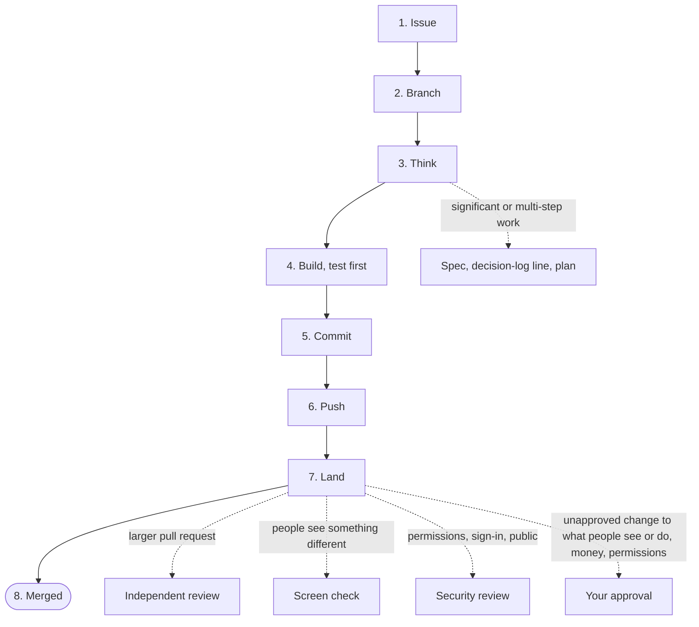

# The dev-workflow workflow

How work goes in a project set up with the `dev-workflow` plugin: what each step is for, and what runs underneath. For install, settings and the full list of hooks, see the [README](../README.md).

## At a glance

There is one workflow, not several. Every task follows the same spine: an issue, a branch, the work done test-first, a commit, a push, and landing the pull request. The size and kind of the work decide which extra steps join in: a spec and plan for big decisions, an outside review for big changes, a screen check when people will see something different, your approval when a change alters what people see or do.



Solid arrows are the spine. Dashed arrows are optional steps that join in when their condition holds.

| # | Step | In one line |
|---|---|---|
| 1 | Issue | Say what the work is and when it's done |
| 2 | Branch | Name the branch after the issue |
| 3 | Think | Decide before building. Big decisions get a spec, big jobs a plan |
| 4 | Build | Write the test first, then the code, to the project's conventions |
| 5 | Commit | Git checks formatting and the commit message |
| 6 | Push | Git runs `check` and keeps you off the default branch |
| 7 | Land | Verify, review, open the pull request, raise the version if needed, merge it when green |
| 8 | Merged | The repo is tidied, the new version is tagged, and you hear what landed |

You describe the work in plain words. Claude does the steps and tells you which skill it is using ("Using land to ..."). You step in where a step needs your decision or your yes.

### The Superpowers skills

Superpowers is a separate plugin. The rules a project gets name six of its skills as the process, and `dev-workflow` adds its own around them.

| Skill | Role in the workflow |
|---|---|
| `brainstorming` | Shapes a new idea before building (step 3) |
| `writing-plans` | Writes a plan for multi-step work (step 3) |
| `test-driven-development` | Writes the test first (step 4) |
| `systematic-debugging` | Finds the cause of a failure, including a failing `verify` (steps 4 and 7) |
| `verification-before-completion` | Run it and read the output before claiming it works (step 7, the report) |
| `receiving-code-review` | Checks each review finding against the code before acting (step 7, with a review) |

Its `finishing-a-development-branch` is replaced by `/dev-workflow:land`, which has no merge, pull request or keep question. This guide doesn't describe how Superpowers works inside. It only says where the workflow calls on it.

## The steps

### 1. Issue

**What it's for.** An issue gives the work an objective, a scope and acceptance criteria, so everyone can tell when it's done.

**What you do.** Describe what you want and ask for an issue, or let Claude open one. Every meaningful task has one.

**What happens underneath.** This is a rule in the project's `AGENTS.md` (Workflow section). No hook checks that an issue exists. Its number then travels: into the branch name, every commit subject, the pull request's `Closes #<issue>`, and `land`, which reads the issue with `gh issue view` to check the acceptance criteria.

### 2. Branch

**What it's for.** One branch per issue keeps each pull request about one thing.

**What you do.** Nothing. Claude creates `<type>/<issue>-<slug>`, like `feat/12-search`. The type is one of `feat`, `fix`, `docs`, `style`, `refactor`, `perf`, `test`, `build`, `ci`, `chore` or `revert`.

**What happens underneath.** Work happens in place on the branch: no worktree, and no question to protect a running dev server. `commit-msg` reads the issue number from the branch name (step 5). On a branch that doesn't match the pattern, it doesn't ask for a number.

### 3. Think

**What it's for.** To decide before building. Most tasks need only a moment here. Significant ones need more.

**What you do.** For a product or domain decision, answer Claude's questions. It asks one at a time and gives its recommendation first. Tooling details get a sensible default, with no debate. For a new project with no stack, `/dev-workflow:choose-stack` asks what decides it (where it runs, who operates it, data limits, licences, what the PoC and production need).

**What happens underneath.** `brainstorming` shapes the idea. A significant product or architecture decision becomes a spec in `docs/superpowers/specs/` that you approve, plus one line in `docs/decisions.md` linking it. Multi-step work gets a plan in `docs/superpowers/plans/`, linked from its issue. Specs and plans count as product and design thinking, so they go to the non-coding model (see [Models](#models)). These are rules. No hook enforces them.

### 4. Build, test first

**What it's for.** A failing test first proves the change is needed and, afterwards, that it works.

**What you do.** Ask for the work. Skills come in on their own.

**What happens underneath.**

- `test-driven-development` writes the test first, for every feature, bug fix, refactor and behaviour change. `systematic-debugging` takes over on a failure.
- `/dev-workflow:conventions-code` comes in when you decide where code, a query or a permission check goes, add a table, or change how data is read or saved. `/dev-workflow:conventions-ui` comes in for a screen, form, label or message.
- Context7 supplies current docs, and Serena reads and changes code by symbol.
- The Claude Code hooks watch each command and edit as it happens: `--no-verify` is blocked, a database reset asks for your yes, a workflow gaining a per-PR trigger asks for your yes. See [When something stops you](#when-something-stops-you).
- Code goes to the coding model at its effort.

### 5. Commit

**What it's for.** To keep history readable and every commit tied to its issue.

**What you do.** Nothing. Claude commits with a subject like `feat: add product search (#12)`.

**What happens underneath.** Git runs two hooks, copied into `.githooks/` by setup:

- `pre-commit` runs the project's staged-file formatting checks (`formatCheckStaged`), which only check and never rewrite. It also blocks a staged workflow that gains a `push`, `pull_request` or `pull_request_target` trigger, unless the file is in `ciAllowlist`. If a file has unstaged changes, it can't be checked: "has unstaged changes, so what's staged can't be checked".
- `commit-msg` requires a Conventional Commit subject, ending with `(#<issue>)` on a `<type>/<issue>-<slug>` branch, and rejects AI attribution. `fixup!` and `squash!` subjects pass during work.

If it stops, the commit doesn't happen, and the message says why:

```text
commit-msg: this branch is for issue #12: end the subject with (#12), got: feat: add search
```

Fix the thing named and commit again. Never skip the hooks: `git commit --no-verify` (and `-n`) is blocked in Claude's commands.

### 6. Push

**What it's for.** To make sure what leaves your machine passes the project's checks, and never lands on the default branch by accident.

**What you do.** Nothing. Claude pushes the branch.

**What happens underneath.** `pre-push` does three things:

- It refuses a direct push to the default branch ("don't push directly to main: open a pull request"). A new repo's first push, when the remote has no branches yet, is allowed.
- It runs the project's `check` command (format, lint, typecheck, unit tests) on the checkout. If a pushed ref isn't what's checked out, it fails, since `check` couldn't have run on it. If `check` fails, you see `pre-push: the check failed: <command>` and nothing is pushed.
- It warns if the work tree has uncommitted changes, which the push doesn't include.

Some pushes go out without the check, because they put no new code on the remote:

- Deleting a branch or a tag.
- Notes.
- A tag on a commit already in the remote's default branch, such as a version tagged after its pull request merged. That commit was checked before it merged.

Any other tag needs its commit to be what's checked out, and the check runs.

With no `check` command configured, it fails visibly instead of passing silently. A `check` of only spaces counts as none.

### 7. Land

**What it's for.** To finish the work properly: confirm it meets the issue, prove it, get it reviewed as far as its size calls for, and merge it.

**What you do.** Say "land this", or "this is done, merge it". Answer if `land` asks for your approval (see [Variations](#variations)).

**What happens underneath.** `/dev-workflow:land` goes through these parts in order:

1. **Acceptance criteria.** Reads the issue and checks each criterion against the work, not against memory.
2. **Verify.** Runs `verify` as its own command and reads the result. With no `verify`, it runs `check` and says so. A failure goes to `systematic-debugging`.
3. **Reviews, as needed.** `/dev-workflow:independent-review` for a larger change, `/dev-workflow:screen-check` if anything people see changed, `/security-review` for permissions, sign-in or anything public. Findings are fixed test-first and `verify` runs again.
4. **Docs.** `AGENTS.md` and the decision log are current in this pull request, and so are a README and docs if the project has them.
5. **Pull request.** Pushes (step 6 runs again), then `gh pr create` with a Conventional Commit title ending in the issue number, a body saying what changed and what was verified, then `Closes #<issue>`.
6. **Raise the version.** Once everything is green, and only in a project with a `versionFile` and no release-please (see [Versions and releases](#versions-and-releases)). It runs the plugin's `scripts/land/raise-version.sh` with the pull request's title, and says one of four things:
   - `raised <old> <new>`: the new version is written into `versionFile` and committed on the branch as `chore: release <new> (#<issue>)`. `land` pushes it, and `pre-push` runs `check` on it.
   - `unchanged <type>`: the type, such as `docs` or `chore`, changes no version.
   - `skip`: it says why, such as release-please, no `versionFile`, a pre-release version, or a version you already raised by hand in this pull request.
   - A failure, reported and never worked around, such as a title that isn't a Conventional Commit.

   The bump comes from the title's type, as release-please's does: `feat` raises the minor, `fix` and `perf` the patch, a `!` before the colon the major, and other types nothing. Before 1.0.0 each step is one lower: a breaking change raises the minor, a feature the patch. The old version is the one on origin's default branch. If the default branch has moved on, `land` merges it into the branch first (a merge, so nothing pushed is rewritten), runs `verify` again, and raises the version again, so two pull requests can't claim the same number.
7. **Merge when green.** Then, as its own command: `gh pr merge <n> --squash --subject "<title>" --body "" --delete-branch`.

Claude Code hooks stand behind these. They block a merge chained after a test command, a local merge into the default branch, a squash merge without a blank message, a pull request title that isn't a Conventional Commit, a body without a closing keyword, and AI attribution in `gh` text. The default branch the local-merge rule protects is the one the project file names (`defaultBranch`), else origin's, else `main`.

If a merge is blocked, `land` stops and asks. It never works around it: no other merge method, no `--admin`, no `--no-verify`.

### 8. Merged

**What it's for.** To leave the repo clean and tell you what happened.

**What you do.** Read the report.

**What happens underneath.** `land` switches to the default branch and runs `git pull --ff-only`, deletes the local branch (after checking the pull request is `MERGED`, since a squash merge looks unmerged to `git branch -d`), runs `git fetch --prune`, tags the version, and confirms the issue closed. Then it reports, using `verification-before-completion`: what landed, any version tagged, and what was verified, including each review and what was skipped or failed. If setup applied the GitHub repo settings you approved, GitHub itself also enforces squash-only merges, the pull request title as the subject, a blank message, and deleting merged branches.

**The version tag.** A version is the SemVer number of the code, and every version is a git tag holding the bare number, like `1.4.0`, never `v1.4.0`. Without release-please, `land` raises the version in the project's `versionFile` just before the merge, when the pull request's type calls for it (step 7). After the merge, it runs the plugin's `scripts/land/tag-version.sh` with the merge commit. The script tags the commit that set the version, and says one of three things:

- `tagged`: the tag was missing, and now it's created and pushed.
- `done`: the tag was already there. A merge that raised no version finds this, such as a `docs` or `chore` one. So does a version you tagged by hand.
- `skip`: it says why nothing is tagged here, such as no `versionFile` set, or release-please doing the tagging.

An error is reported, never worked around. A tag is never moved or deleted to make it pass. With release-please (see [Versions and releases](#versions-and-releases)), `land` neither raises nor tags.

## Variations

Same spine, different extras. Each row says what changes.

| Situation | Adds | Skips or changes |
|---|---|---|
| **A small fix** | Nothing extra. A test that fails without the fix, then the fix. | Step 3 is a moment, not a spec. No independent review under the size threshold. No screen check if nothing people see changed. The issue can be short, but it still has acceptance criteria. |
| **A feature** | `brainstorming` to shape it. Tests for the new behaviour. | Steps 1 to 8 as written. Extra steps join only if the feature is large, touches screens or touches permissions. |
| **A significant product or architecture decision** | You answer questions one at a time. A spec you approve in `docs/superpowers/specs/`, and one line in `docs/decisions.md` linking it, as `YYYY-MM-DD: what was decided. [Spec](superpowers/specs/<file>.md)`. | Step 3 becomes real work. The spec and the log line go in the same pull request as the work they start. |
| **Multi-step work** | A plan in `docs/superpowers/plans/`, linked from the issue, written with `writing-plans`. | Still one squash-merged pull request per issue. No stacked pull requests unless an issue is too big for one. `maintain` marks a finished plan at its top. |
| **A new project** | `/dev-workflow:setup`, which hands over to `/dev-workflow:choose-stack` when no stack is decided. The stack spec and its log line. | Setup comes before step 1. Afterwards you fill in the `_Fill in:_` parts of the project's `AGENTS.md` and commit the setup on a branch. |
| **An existing project, or one set up with an older version** | `/dev-workflow:setup` again. It upgrades what it owns, and shows what you changed. | Nothing changes in a project until you run it there. The session-start check says when the project is behind the plugin. See [Setup and upgrading](#setup-and-upgrading). |
| **A project with screens** | `/dev-workflow:conventions-ui` while building. `/dev-workflow:screen-check` before it's done. End-to-end tests of each flow. | `land` runs the screen check whenever anything people see changed. See below. |
| **A project with a database** | `/dev-workflow:conventions-code`'s data rules. Migrations only. A hook that asks before a database reset. | See below. |
| **A larger pull request** | `/dev-workflow:independent-review` by another model, before the merge. | See below. |
| **A change that alters what people see or do, money rules or permissions, and you haven't approved it** | `land` asks you first. | The one case where `land` doesn't merge on its own. Everything else lands without a question. |
| **A project reaching 1.0.0** | A README and docs, kept current in every pull request after. | `land` says so if a project at 1.0.0 or later has none. `enable-releases` says to stop before a release that reaches 1.0.0 if they're missing or out of date. |
| **A change that isn't a feature or a fix**, such as `docs`, `chore`, `test` or `refactor` | Nothing extra. | `land` raises no version (`unchanged`), so the merge adds no tag. A `feat`, a `fix`, a `perf` or a `!` does. |
| **A flaky test** | Finding the root cause. | No rerun or retry first. A rerun is fine only for a proven environmental cause, such as the laptop sleeping, and you say so. |

**Screens.** `screen-check` lists every touched screen, then checks each in a browser: light and dark, a 360 px phone and a desktop width, keyboard only, empty, filled and long content, loading and failure, and the console. It fixes what it finds and looks again. With no browser tool, it says so and asks whether to go ahead. It never skips silently, and never calls a screen checked that nobody looked at. The rules it holds screens to are in `/dev-workflow:conventions-ui`: theme tokens, copy, accessibility, phones and touch.

**Database.** `conventions-code` says to validate on the server, enforce permissions in the data layer as well as in code and test them, give every new table its access rules and a test in the same pull request, make a multi-row save one transaction, and make reads that list or total rows get every row. Tests use an isolated stack of their own. A command in `databaseResetCommands`, or the project's stack's reset commands, makes the hook ask for a person's yes before it runs. A reset hidden inside a script of its own isn't something the hook can see.

**Larger.** A pull request is larger when it has more than `review_threshold_lines` changed lines (default 300, set in `/config`, counted with `git diff --shortstat origin/<default>...HEAD`), or when it changes permissions, sign-in, money rules or public surfaces. Judgment can ask for a review on a smaller one. `independent-review` writes a narrow brief naming the files, announces the reviewer by its exact name, and runs the reviewer command. If Codex is missing or the command fails, it says so and asks whether to go ahead without. It never calls a failed review a pass. Each finding is checked against the code: valid ones are fixed test-first, invalid ones get an explanation, and a product call goes to you. Then `verify` runs again before any merge.

## Occasional routines

### Setup and upgrading

Run `/dev-workflow:setup` once per project, and again after updating the plugin. The update steps are in the README's [Updating](../README.md#updating).

- **It reads first.** With an `origin`, it runs `git remote set-head origin --auto`, so the default branch it reads is origin's current one, not a copy from when the repo was cloned.
- **It asks** only what it can't read, one question at a time, recommendation first: the stack, the commands (`check` is required, as `pre-push` runs it), whether there are screens, a database and its reset commands, the default branch if there's no remote, the version file, which per-PR workflows may stay (it recommends none), and four approvals. The approvals are: letting the agent run `gh pr merge` in auto mode, the GitHub repo's merge settings, installing missing plugins, and moving existing git hooks into `.githooks`.
- **The version file** is where the project keeps its version, saved as `versionFile`. It's the file `land` writes the new version into before a merge, and reads after it to tag the version. Setup suggests one of `package.json`, `pyproject.toml`, `Cargo.toml` or `VERSION` at the root, once it has read that the file holds a version. With none, it can recommend adding one, starting at `0.1.0`, or say that versions then aren't tagged. It skips the question when release-please is set up, since release-please tags versions.
- **It writes** nothing until you say yes to a plan that lists every file as create, update, keep or conflict. After the yes: `.claude/dev-workflow.json`, the rules in `AGENTS.md`, a `CLAUDE.md` that imports it, the git hooks in `.githooks/` and turning them on, the attribution settings, and `docs/decisions.md` and `docs/maintenance.md` if they're missing.
- **It never overwrites** what you changed. A managed section in `AGENTS.md` is replaced only if you haven't edited it. If you have, your text stays and setup shows the difference. Text outside the markers is never touched. Text in an old `CLAUDE.md` moves into `AGENTS.md` first, never dropped. If git already runs hooks from another folder, setup leaves that setting alone and tells you what to add there. A rerun with nothing to change reports only `keep`.
- **A fresh clone** has no git hooks. Run `git config core.hooksPath .githooks`, or let `npm install` do it if setup added a `prepare` script.

### Versions and releases

**Versions come first.** A version is the SemVer number of the code (`0.x` during alpha). A GitHub Release is a separate, optional thing on top. Every version, in every project, is a git tag holding the bare number, like `1.4.0`, never `v1.4.0`. Tags are plain git, so they work anywhere.

- **Without release-please,** `land` raises the version in the project's `versionFile` just before each merge that needs it, from the pull request title's type (step 7), as one commit on the branch. After the merge, it tags the commit that set it and pushes the tag (step 8). A pre-release version, or one you already raised by hand in the pull request, is left alone. `pre-push` lets that tag through without the check, since the commit was checked before it merged.
- **With release-please,** it raises the version, tags it bare, and publishes a GitHub Release with the changelog. `land` neither raises nor tags. It batches merges into one release, which you start. The rest of this section is about that. release-please works only with GitHub, because it uses GitHub's API.

**GitHub Releases are optional.** CI runs only for releases, never per pull request. release-please reads the Conventional Commits on the default branch, which are your squashed pull request titles, to choose each version.

**How.** Run `/dev-workflow:enable-releases` once. It writes release-please's config, which makes bare tags, and a workflow that runs only when you start it. An existing config isn't changed. If it writes `v` tags, it keeps them. To switch, set `include-v-in-tag` and `include-component-in-tag` to `false` yourself, and don't mix the two formats.

**Each release takes two manual runs.** Start the workflow from the Actions tab, or with `gh workflow run release-please.yml`.

1. The first run opens or updates the release pull request, holding the changelog and versions.
2. You merge that pull request the usual way: squashed, with a blank message.
3. The second run tags the release and publishes it on GitHub.

In the repo's Actions settings, "Allow GitHub Actions to create and approve pull requests" must be on.

**The optional release check** runs the project's `check` on release-please's pull requests only, and goes in `ciAllowlist`. It wants a token secret of its own, such as `RELEASE_PLEASE_TOKEN`. With the default `GITHUB_TOKEN`, the check's runs on each release pull request wait for someone with write access to approve them. A token of its own lets them run unattended. Without the check, the release workflow can use `GITHUB_TOKEN`. The skill recommends leaving the check out.

### Maintenance

`/dev-workflow:maintain` is started only by you, never on a schedule. It starts from a clean, updated default branch and sweeps six areas, each with its own issue and pull request if it changes files:

| Area | What it does |
|---|---|
| Branches | Deletes only branches proven merged. Lists the rest for you |
| Dead code | Runs the project's `deadCode` command, and checks each finding |
| Dependencies | Latest verified stable versions, one major upgrade at a time, the `audit` command |
| Code smells | Oversized files, duplication and broken boundaries, in code changed since the last run |
| Docs | `AGENTS.md`, README and decision log against the code, finished plans, issues already met |
| Methodology | Reruns the setup check, and reports a newer reviewer or second-opinion model, with the same code as the session-start check |

Anything that alters what people see or do, money rules or permissions waits for your approval. The run ends with one line added to `docs/maintenance.md`, as `- YYYY-MM-DD: what was done`.

**The reminder.** The session-start check reads the last line of that file. After `maintenance_interval_days` (default 30) it says: "maintenance is overdue: the last run was N days ago, and it's due every M days. Run /dev-workflow:maintain."

### The session-start check

Every session in a set-up project, a hook looks over the setup and prints one line for each problem. It's silent when all is well. The lines go to you and to Claude. It reads files and starts nothing slow, and it never gets in the session's way. It checks:

- `git`, `gh` and `jq` are on the PATH.
- The git hooks are on: "git hooks aren't active here, so nothing checks commits or pushes." The fix is `git config core.hooksPath .githooks`.
- `.claude/dev-workflow.json` holds one JSON object, and isn't older than the plugin. It doesn't check the file against the schema. If the file is broken, it says to fix it or run setup. If it's older: "this project was set up with an older version of the plugin ... Run /dev-workflow:setup to upgrade it."
- The plugins the project relies on are installed. The screen plugins only count in a project with screens.
- Maintenance isn't overdue.
- A newer GPT model than the reviewer or the second-opinion model uses, when Codex lists one. It only says so. You change the setting in `/config`.

## When something stops you

Two things can stop an action, and they need different responses.

| | A block | A request for your yes |
|---|---|---|
| **What it is** | The action is refused, with a message saying why and what to do instead | The action waits for a person to approve it |
| **Where it comes from** | Git hooks, and Claude Code hooks | Claude Code hooks only |
| **What to do** | Do what the message says: fix the cause, or use the allowed way. Don't work around it | Read what it will do, then approve or refuse |
| **Examples** | `--no-verify`; a merge chained after tests; a local merge into the default branch; a bad commit message, pull request title or body; AI attribution; a failing `check`; a direct push to the default branch | A database reset command; a workflow gaining a per-PR trigger |

What you'll see, in the hooks' own words:

```text
dev-workflow: this merges in the same command as a test. Run the tests, read the results, then merge in a command of its own.
dev-workflow: this is a local merge into main. Merge through a pull request instead.
dev-workflow: a pull request body needs a closing keyword for its issue, like "Closes #12".
dev-workflow: this looks like a database reset, which destroys data, so it needs a person's yes.
```

For a request, the hook asks for a yes: a database reset, or a workflow that gets a trigger such as `pull_request`. Where there's no person to answer, such as in `claude -p`, a request acts as a denial. This was seen in real sessions. What auto mode does with one in an interactive session wasn't tested. See `docs/hook-behaviour.md`. To keep a per-PR workflow on purpose, list it in `ciAllowlist` through setup.

Some things to know:

- **Hooks act only in set-up projects.** The Claude Code hooks look for `.claude/dev-workflow.json` first, and the git hooks exist only where setup wrote them. In any other repo they do nothing.
- **Claude Code hooks apply only to Claude's own commands and edits.** Git hooks apply to anyone who commits there, once they're turned on.
- **A hook that breaks blocks.** If a check can't run, for example because `jq` is missing or the project file is broken, the action is refused rather than let through. The message says what to fix, usually "run the setup skill".
- **They catch mistakes. They aren't a security boundary.** They read a command's text, so a determined workaround can get past them. Judgment rules such as test-first and honest reporting stay as guidance in `AGENTS.md` and the skills.
- **If a merge is blocked,** `land` stops and asks.

## Models

Work goes to a model by its kind. The choices are the plugin's settings in `/config`, so no model name is written in a rule or a skill. The README's [Settings](../README.md#settings) lists each setting and its default.

| Work | Goes to |
|---|---|
| Writing code | The model for coding, at its effort (`model_coding`, `effort_coding`) |
| Code reviews | The reviewer, through `/dev-workflow:independent-review` (`reviewer_command`, `reviewer_name`) |
| Docs, READMEs and similar writing | The model for docs, at its effort (`model_docs`, `effort_docs`) |
| Research, product thinking, design critique, specs and plans | The model for non-coding work, or its alternative (`model_noncoding`, `model_noncoding_alt`) |

Subagents get the model from these settings. The main session's model is your choice. Model routing is guidance in `AGENTS.md`, not something a hook enforces. Whenever another AI model is consulted, Claude tells you, naming the exact model.

## Words used

| Word | Meaning |
|---|---|
| **Issue** | A GitHub issue holding a task's objective, scope and acceptance criteria |
| **Branch name** | `<type>/<issue>-<slug>`, like `fix/14-empty-cart`. The issue number is read from it |
| **Conventional Commit** | A subject shaped `<type>(<scope>): <subject>`, like `feat: add search (#12)`. Commits and pull request titles use it |
| **Version** | The SemVer number of the project's code, kept in its `versionFile`. Every version is marked by a git tag |
| **Tag** | A git tag holding the bare version, like `1.4.0`, never `v1.4.0`. `land` makes it after the merge it raised the version for, or release-please does |
| **GitHub Release** | An optional page on GitHub for a version, with its changelog. Only projects that run `/dev-workflow:enable-releases` have them. It's separate from the version and its tag |
| **Squash merge** | Merging a pull request as one commit on the default branch, titled with the pull request's title and with a blank message |
| **Spec** | An approved write-up of a significant decision, in `docs/superpowers/specs/` |
| **Plan** | The steps of multi-step work, in `docs/superpowers/plans/`, linked from the issue |
| **Decision log** | `docs/decisions.md`: one line per significant decision, linking its spec |
| **Managed section** | A part of the project's `AGENTS.md` that the plugin owns and can upgrade. Your edits to one are kept and shown on a rerun |
| **Project file** | `.claude/dev-workflow.json`. The facts the hooks need about the project. Its presence turns the Claude Code hooks on |
| **`check`** | The project's fast command: format, lint, typecheck, unit tests. `pre-push` runs it |
| **`versionFile`** | The file that holds the project's version, such as `package.json`. `land` raises the version in it before a merge, and reads it to tag the version |
| **`verify`** | `check` plus the slower database and end-to-end tests. `land` runs it |
| **Git hook** | A script git runs on commit and push. Setup copies them into `.githooks/`. They work for anyone who commits there |
| **Claude Code hook** | A script that comes with the plugin and runs before Claude's commands and edits, and at session start |
